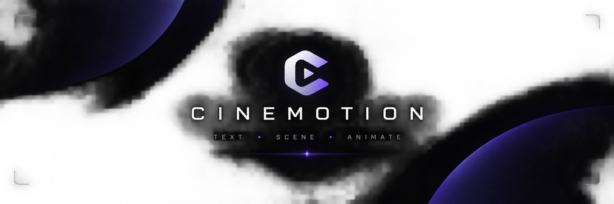

# CINEMOTION




Advanced AI animation skill for Claude and AI agents. Describe a scene in plain words; CINEMOTION plans it, chooses an engine, and produces the animation code or preview.

Created and maintained by Aditya (@cixcex).

## Why CINEMOTION

- **Director workflow** — turns a sentence into scenes, camera, lighting, continuity, and engine code.
- **Android-first** — designed for Claude Android chat; no terminal required for basic use.
- **Five engines** — Three.js, Blender, HTML/CSS/JS, SVG/Canvas, or optional configured AI video.
- **Low cost by default** — local-first, compact plans, no external API calls unless you ask.
- **Continuity rules** — locks character cards, environment layout, lighting, and scene endings.
- **Honest outputs** — clearly labels plan, code, preview, render, or video. No fake renders.

## 30-second quick start

1. Download [`releases/cinemotion-claude-skill.zip`](releases/cinemotion-claude-skill.zip).
2. Install it through Claude's supported Skills interface:
   - Android/desktop/web: **Settings → Capabilities → enable code execution**, then **Customize → Skills → + → Upload a skill**.
   - Claude Code: copy `.claude/skills/cinemotion` into your project or `~/.claude/skills/`.
3. Ask:

> Create a 15-second cinematic POV animation of someone waking up in their bedroom, getting out of bed, walking outside, and entering a convenience store at night.

See [docs/QUICKSTART.md](docs/QUICKSTART.md) and [docs/ANDROID-GUIDE.md](docs/ANDROID-GUIDE.md).

## Efficiency modes

| Mode | Trigger phrase | Behavior |
|---|---|---|
| Low cost | default | Compact plan, HTML/CSS/JS/Canvas preview, no external APIs |
| Balanced | “Switch to balanced mode” | Moderate detail, Three.js or simple Blender script |
| Maximum quality | “Use maximum quality” | Full detail, advanced camera/lighting, optional paid video API |

CINEMOTION never claims third-party APIs are free and never claims a video rendered when only code was produced.

## Engine selection

| If you want | CINEMOTION prefers |
|---|---|
| Real-time 3D browser preview | Three.js |
| Professional offline render | Blender Python scripting |
| Fast mobile preview | HTML/CSS/JS |
| Compact 2D loop | SVG/Canvas |
| Final AI video | Optional configured provider only |

Details: [docs/ENGINES.md](docs/ENGINES.md).

## Repository map

```text
cinemotion/
├── README.md                          # you are here
├── LICENSE                            # MIT
├── .claude/skills/cinemotion/         # Agent Skills package
│   ├── SKILL.md                       # main skill instructions
│   ├── references/                    # load-on-demand technical refs
│   ├── templates/                     # reusable scene-plan templates
│   └── scripts/                       # validation + packaging
├── docs/                              # install, Android, usage, engines, cost
├── examples/                          # runnable preview projects
├── assets/branding/                   # banner, mark, logo
└── releases/                          # generated ZIP deliverables
```

## Examples

| Example | What it demonstrates |
|---|---|
| [`examples/pov-animation`](examples/pov-animation) | First-person night-walk scene plan + canvas preview |
| [`examples/anime-environment`](examples/anime-environment) | Anime/game-inspired street environment preview |
| [`examples/cinematic-night-scene`](examples/cinematic-night-scene) | Neon lighting, rain, reflections |
| [`examples/vertical-short-video`](examples/vertical-short-video) | 9:16 vertical beat structure |

Each example contains a `scene-plan.md`, a runnable `index.html`, and `main.js`.

## Compatibility

- Claude Android (primary target)
- Claude Desktop / Claude Web
- Claude Code
- Other clients implementing the open [Agent Skills](https://agentskills.io/) format

Exact menu labels can vary by client and version. If your Android build does not expose custom skill upload, use desktop/web or Claude Code.

## Validation

Run the included checks before a release:

```bash
python3 .claude/skills/cinemotion/scripts/validate_skill.py
python3 .claude/skills/cinemotion/scripts/package_skill.py
```

The validator checks Agent Skills frontmatter, required files, references, examples, attribution, and scans the working tree for accidental secret patterns.

## Docs

- [Installation](docs/INSTALLATION.md)
- [Android guide](docs/ANDROID-GUIDE.md)
- [Quickstart](docs/QUICKSTART.md)
- [Usage](docs/USAGE.md)
- [Engines](docs/ENGINES.md)
- [Cost optimization](docs/COST-OPTIMIZATION.md)
- [Architecture](docs/ARCHITECTURE.md)
- [FAQ](docs/FAQ.md)

## Contributing

See [CONTRIBUTING.md](CONTRIBUTING.md) and [CODE_OF_CONDUCT.md](CODE_OF_CONDUCT.md). Report security issues via [SECURITY.md](SECURITY.md).

## License

MIT License — see [LICENSE](LICENSE).

## Credits

Created and maintained by Aditya (@cixcex).

- GitHub: https://github.com/cixcex
- Instagram: https://instagram.com/cixcex
- Email: kalebcherry2016@gmail.com

CINEMOTION is an independent open-source skill. It is not affiliated with, endorsed by, or sponsored by Anthropic, Blender, Three.js, or any other third-party project. All third-party names and logos belong to their respective owners.
